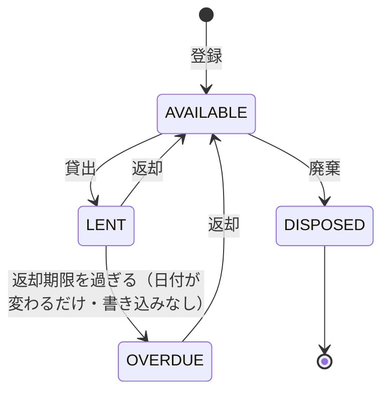
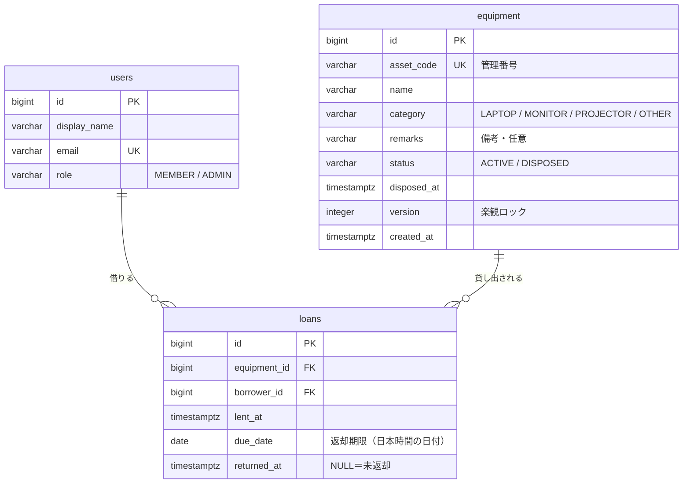
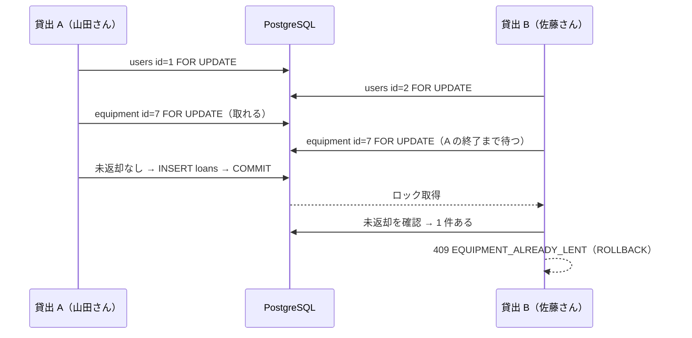

# 要件と設計 — 社内備品の貸出管理 API

- 版: v0.1（2026-10-04）／状態: 実装前の設計
- この文書は Claude Code（Anthropic の AI）で作成しました。
- テストの組み立ては [テスト計画.md](テスト計画.md) に分けています。

## 10 分で読むなら

| 順 | 読む節 | そこで分かること |
|---|---|---|
| 1 | [§4 業務ルール](#4-業務ルール) | 何を禁止し、どの順で判定するか |
| 2 | [§8 同時実行](#8-同時実行二重貸出をどう防ぐか) | 二重貸出を DB 制約で防ぎ、楽観ロックを別の目的に使う理由 |
| 3 | [§10 MyBatis の動的 SQL](#10-mybatis-の動的-sql-とページング) | 検索条件・並び替えの許可リスト・ページング |
| 4 | [§13 採らなかった案](#13-採らなかった案と理由) | JPA ではなく MyBatis にした理由など |
| 5 | [テスト計画 §5](テスト計画.md#5-同時実行テスト) | 二重貸出の競合を実際に並列で起こすテスト |

---

## 1. 目的と読み手

- 目的: 社内の備品（ノート PC・モニター・プロジェクターなど）の登録・検索・貸出・返却・延滞の確認を行う REST API。
- このリポジトリは**見本**です。業務ロジックの設計、SQL（MyBatis の動的 SQL）、トランザクションと同時実行、テストの組み立てを、短時間で読める量に収めることを優先します。機能の多さは目標にしません。
- 想定する読み手: Java / Spring Boot のコードを読むエンジニア。

## 2. 範囲と範囲外

| 範囲（作る） | 範囲外（作らない） |
|---|---|
| 備品の登録・検索・詳細・更新・廃棄 | ログイン・認証基盤（§12 のデモ方式で代用） |
| 貸出・返却・貸出一覧・延滞一覧 | 利用者の登録・編集 API（初期データで用意） |
| 入力検証とエラー応答（ProblemDetail） | 予約・期限の延長申請・承認フロー |
| OpenAPI（Swagger UI）による API 定義の公開 | 通知（メール・チャット）・画面（UI） |
| DB のマイグレーション（Flyway） | 数量管理（1 備品＝1 台。「モニター 10 台」は 10 件で登録） |
| 自動テスト一式と CI | 監査ログ・物理削除・CSV 入出力・本番環境へのデプロイ |

## 3. 用語とユースケース

| 用語 | 意味 |
|---|---|
| 備品 | 管理番号（例 `PC-0001`）を持つ 1 台の物。区分はノート PC・モニター・プロジェクター・その他 |
| 貸出 | 1 人の利用者が 1 台の備品を借りている記録。返却するまで「未返却」 |
| 返却期限 | 貸出時に決める日付（日単位・日本時間） |
| 延滞 | 未返却のまま返却期限の翌日以降になった状態。保存せず、毎回「今日」と比べて求める |
| 廃棄 | 使わなくなった備品の扱い。取り消さない。廃棄済みは貸せない |
| 利用者の役割 | `MEMBER`（一般）と `ADMIN`（備品の管理者） |

| # | 誰が | 何をする |
|---|---|---|
| UC-1 | ADMIN | 備品を登録する・名称や区分を直す・廃棄する |
| UC-2 | 全員 | 備品をキーワード・区分・貸出状態で探す |
| UC-3 | 全員 | 空いている備品を返却期限を決めて借りる |
| UC-4 | 借りた本人か ADMIN | 返却する |
| UC-5 | 全員 | 貸出の一覧を見る（MEMBER は自分の分だけ） |
| UC-6 | ADMIN | 延滞の一覧を、延滞日数の多い順に見る |

### 受け入れ条件（テスト名の元になる文）

| ID | 前提（Given） | 操作（When） | 結果（Then） |
|---|---|---|---|
| AC-01 | ADMIN | 正しい入力で備品を登録 | 201・`Location` ヘッダ・貸出状態は `AVAILABLE` |
| AC-02 | 同じ管理番号が登録済み | 登録 | 409 `ASSET_CODE_DUPLICATED` |
| AC-03 | MEMBER | 登録・更新・廃棄・延滞一覧 | 403 `FORBIDDEN` |
| AC-04 | 備品が複数 | キーワード・区分（複数）・貸出状態で検索 | 条件に合う物だけが、指定の並び順とページで返る。`%` `_` は文字として扱う |
| AC-05 | — | 許可していない並び替えキーで検索 | 400 `VALIDATION_FAILED`（SQL は実行しない） |
| AC-06 | 空いている備品 | 今日〜14 日後の期限で借りる | 201・その備品は `LENT` |
| AC-07 | 貸出中の備品 | 借りる | 409 `EQUIPMENT_ALREADY_LENT` |
| AC-08 | 廃棄済みの備品 | 借りる | 409 `EQUIPMENT_DISPOSED` |
| AC-09 | 延滞中の貸出がある利用者 | 別の備品を借りる | 422 `BORROWER_HAS_OVERDUE` |
| AC-10 | 未返却が 3 件の利用者 | 4 件目を借りる | 422 `LOAN_LIMIT_EXCEEDED` |
| AC-11 | — | 期限を昨日・15 日後で借りる | 422 `DUE_DATE_OUT_OF_RANGE`（今日と 14 日後は通る） |
| AC-12 | 未返却の貸出 | 本人か ADMIN が返却 | 200・`returnedAt` が入る。期限後の返却は `returnedLate=true`。他の MEMBER は 403、返却済みは 409 `LOAN_ALREADY_RETURNED` |
| AC-13 | 期限切れ・期限内・返却済みが混在 | 延滞一覧 | 期限切れの未返却だけが、延滞日数の多い順に返る |
| AC-14 | 貸出中の備品 | 廃棄 | 409 `EQUIPMENT_IN_USE`。空いていれば廃棄でき、以後は貸せず、検索の既定の結果から消える |
| AC-15 | 備品を 2 人が同じ版で開いた | 2 人目が更新 | 409 `VERSION_CONFLICT`（1 人目の変更を上書きしない） |
| AC-16 | 空いている備品 1 台 | 別々の利用者が同時に借りる | 成功は 1 件だけ。残りは 409 `EQUIPMENT_ALREADY_LENT`。未返却の貸出は 1 件 |
| AC-17 | 未返却 0 件の利用者 | 別々の備品を同時に 6 件借りる | 成功はちょうど 3 件。残りは 422 `LOAN_LIMIT_EXCEEDED`。未返却の貸出は 3 件 |
| AC-18 | 空いている備品 | 廃棄と貸出が同時 | 「廃棄済みなのに未返却の貸出がある」状態が生まれない |
| AC-19 | — | `X-User-Id` なし・存在しない利用者 | 401 `UNAUTHENTICATED` |
| AC-20 | 想定外の例外 | 任意の API | 500 `INTERNAL_ERROR`。SQL やスタックトレースを応答に含めない |

## 4. 業務ルール

| # | ルール | 守る場所 |
|---|---|---|
| R1 | 1 台の備品に未返却の貸出は同時に 1 件まで（二重貸出の禁止） | **DB 制約**（部分一意インデックス）＋サービスの判定 |
| R2 | 廃棄済みの備品は貸さない・更新しない | サービス（備品行のロック後に判定） |
| R3 | 貸出中の備品は廃棄できない | サービス（備品行のロック後に判定） |
| R4 | 返却期限は「今日」から「今日＋14 日」まで（両端を含む） | サービス（今日は `Clock` から） |
| R5 | 延滞中の貸出が 1 件でもある利用者は新しく借りられない | サービス |
| R6 | 1 人の未返却は 3 件まで | サービス（利用者行のロック後に数える） |
| R7 | 返却できるのは借りた本人か ADMIN。返却は 1 回だけ | サービス＋条件付き UPDATE |
| R8 | 備品の登録・更新・廃棄、延滞一覧は ADMIN だけ | サービス |
| R9 | 延滞は「未返却かつ返却期限 < 今日」。保存しない | SQL（今日はアプリから渡す） |

- 数値（14 日・3 件）は `application.properties` の `lending.max-loan-days`・`lending.max-open-loans-per-borrower` で変えられる。業務日付のタイムゾーンは `lending.zone=Asia/Tokyo`。
- 判定の順番（複数に当たる時にどのエラーを返すか）。安い判定から順に行い、ロックを取る前に入力だけで分かる物を弾く。

| 操作 | 判定の順番 |
|---|---|
| 貸出 | ① 期限の範囲（R4・422）→ ② 利用者行をロック → ③ 備品行をロック。無ければ 404 → ④ 廃棄済み（R2・409）→ ⑤ 貸出中（R1・409）→ ⑥ 延滞あり（R5・422）→ ⑦ 件数上限（R6・422）→ 登録 |
| 返却 | ① 貸出が無い（404）→ ② 本人か ADMIN でない（403）→ ③ 条件付き UPDATE が 0 件＝返却済み（409） |
| 廃棄 | ① ADMIN でない（403）→ ② 備品行をロック。無ければ 404 → ③ 廃棄済み（409）→ ④ 貸出中（R3・409）→ 更新 |
| 更新 | ① ADMIN でない（403）→ ② 版つき UPDATE。0 件なら読み直して 404／409 `EQUIPMENT_DISPOSED`／409 `VERSION_CONFLICT` を判定 |

### 状態遷移

保存するのは備品の `status`（`ACTIVE` / `DISPOSED`）と貸出の `returned_at` だけ。API が返す貸出状態（availability）はそこから求める。



`LENT`・`OVERDUE` から `DISPOSED` へは行けない（R3）。いったん返却してから廃棄する。

| availability | 条件 |
|---|---|
| `DISPOSED` | `equipment.status = 'DISPOSED'` |
| `AVAILABLE` | `ACTIVE` で、未返却の貸出が無い |
| `LENT` | `ACTIVE` で、未返却の貸出があり、返却期限 ≥ 今日 |
| `OVERDUE` | `ACTIVE` で、未返却の貸出があり、返却期限 < 今日 |

## 5. データモデル



テーブルは 3 つ（＋ Flyway の管理表）。DDL は `src/main/resources/db/migration/V1__create_tables.sql` に置く。方針は次のとおり。

```sql
CREATE TABLE equipment (
    id          bigint GENERATED ALWAYS AS IDENTITY PRIMARY KEY,
    asset_code  varchar(20)  NOT NULL,
    name        varchar(100) NOT NULL,
    category    varchar(20)  NOT NULL,
    remarks     varchar(500),
    status      varchar(10)  NOT NULL DEFAULT 'ACTIVE',
    disposed_at timestamptz,
    version     integer      NOT NULL DEFAULT 0,
    created_at  timestamptz  NOT NULL,
    CONSTRAINT uq_equipment_asset_code UNIQUE (asset_code),
    CONSTRAINT ck_equipment_category CHECK (category IN ('LAPTOP', 'MONITOR', 'PROJECTOR', 'OTHER')),
    CONSTRAINT ck_equipment_status   CHECK (status IN ('ACTIVE', 'DISPOSED')),
    CONSTRAINT ck_equipment_disposed CHECK ((status = 'DISPOSED') = (disposed_at IS NOT NULL))
);

CREATE TABLE loans (
    id           bigint GENERATED ALWAYS AS IDENTITY PRIMARY KEY,
    equipment_id bigint      NOT NULL REFERENCES equipment (id),
    borrower_id  bigint      NOT NULL REFERENCES users (id),
    lent_at      timestamptz NOT NULL,
    due_date     date        NOT NULL,
    returned_at  timestamptz,
    CONSTRAINT ck_loans_returned_after_lent CHECK (returned_at IS NULL OR returned_at >= lent_at)
);

-- 二重貸出の禁止（R1）: 未返却の行だけを対象にした一意インデックス
CREATE UNIQUE INDEX uq_loans_open_equipment ON loans (equipment_id) WHERE returned_at IS NULL;
-- 延滞一覧（R9）: 未返却の行だけを返却期限で引く
CREATE INDEX ix_loans_open_due_date ON loans (due_date) WHERE returned_at IS NULL;
-- 外部キー側の索引（PostgreSQL は自動では作らない）
CREATE INDEX ix_loans_equipment ON loans (equipment_id);
CREATE INDEX ix_loans_borrower  ON loans (borrower_id);
```

`users` は `id`・`display_name`・`email`（一意）・`role`（CHECK で 2 値）だけの小さな表。

### 制約で守るもの・アプリで守るもの

| 守るもの | 場所 | 理由 |
|---|---|---|
| 二重貸出の禁止（R1） | 部分一意インデックス | どの経路（別のアプリ・手作業の SQL・将来のバグ）から書いても破れない。正しさの最後の砦 |
| 管理番号・メールの一意 | 一意制約 | 同上 |
| 区分・状態・役割の値 | CHECK | 値の追加は DDL 1 行で済み、MyBatis の enum の名前保存とそのまま合う（PostgreSQL の ENUM 型は使わない） |
| 廃棄済みと廃棄日時の整合 | CHECK | 1 行の中で閉じる規則なので DB に置ける |
| 返却日時 ≥ 貸出日時 | CHECK | 同上 |
| 廃棄済みは貸さない・貸出中は廃棄しない（R2・R3） | アプリ（行ロックの後で判定） | 2 つの表にまたがる。トリガで書くと規則が Java から見えず、単体テストもしにくい |
| 期限の範囲・延滞者・件数上限（R4〜R6） | アプリ | 「今日」に依存する、または集計が要る。CHECK では書けない |
| 権限（R7・R8） | アプリ | 利用者の役割は要求ごとに変わる文脈 |

- 時刻はすべてアプリの `Clock` から渡す。**SQL の中で `now()`・`CURRENT_DATE` を使わない**（時刻を決める場所を 1 か所にし、テストで固定できるようにする）。テスト計画 §3 で機械的に検査する。
- `timestamptz` は Java の `OffsetDateTime` で受ける（JVM の既定タイムゾーンに結果を左右させない）。応答の日時は DB から読んだオフセットに頼らず `lending.zone`（日本時間）に揃える。
- ID は `bigint` の IDENTITY。物理削除はしない。

## 6. API 一覧

共通: すべての API に `X-User-Id` ヘッダが要る（§12）。成功時は `application/json`、失敗時は `application/problem+json`。日付は `yyyy-MM-dd`、日時は ISO 8601（オフセット付き）。

| # | メソッド | パス | 権限 | 入力 | 成功 | 主なエラー |
|---|---|---|---|---|---|---|
| 1 | POST | `/api/equipment` | ADMIN | 本文: `assetCode`・`name`・`category`・`remarks`? | 201・`Location`・備品 | 400・403・409 `ASSET_CODE_DUPLICATED` |
| 2 | GET | `/api/equipment` | 全員 | `keyword`?・`category`（複数可）・`availability`?・`sort`?・`page`?・`size`? | 200・備品の一覧（ページ） | 400 |
| 3 | GET | `/api/equipment/{id}` | 全員 | — | 200・備品（未返却の貸出があれば借りている人と期限を含む） | 404 `EQUIPMENT_NOT_FOUND` |
| 4 | PATCH | `/api/equipment/{id}` | ADMIN | 本文: `name`?・`category`?・`remarks`?・`version`（必須） | 200・備品（版が 1 増える） | 400・403・404・409 `EQUIPMENT_DISPOSED`・409 `VERSION_CONFLICT` |
| 5 | POST | `/api/equipment/{id}/dispose` | ADMIN | — | 200・備品（`DISPOSED`） | 403・404・409 `EQUIPMENT_DISPOSED`・409 `EQUIPMENT_IN_USE` |
| 6 | POST | `/api/loans` | 全員（借りる本人） | 本文: `equipmentId`・`dueDate` | 201・`Location`・貸出 | 400・404・409 `EQUIPMENT_ALREADY_LENT`・409 `EQUIPMENT_DISPOSED`・422（3 種） |
| 7 | GET | `/api/loans` | 全員（MEMBER は自分の分だけ） | `state`?（`OPEN`/`RETURNED`/`ALL`・既定 `OPEN`）・`borrowerId`?・`equipmentId`?・`sort`?・`page`?・`size`? | 200・貸出の一覧（ページ） | 400・403（MEMBER が他人の `borrowerId` を指定） |
| 8 | GET | `/api/loans/{id}` | 本人か ADMIN | — | 200・貸出 | 403・404 `LOAN_NOT_FOUND` |
| 9 | POST | `/api/loans/{id}/return` | 本人か ADMIN | — | 200・貸出（`returnedAt`・`returnedLate`） | 403・404・409 `LOAN_ALREADY_RETURNED` |
| 10 | GET | `/api/loans/overdue` | ADMIN | `page`?・`size`? | 200・延滞の一覧（延滞日数の多い順） | 403 |

- 入力の検証（Bean Validation）: `assetCode` は `^[A-Z]{2,4}-[0-9]{4}$`、`name` は 1〜100 字、`remarks` は 500 字まで、`keyword` は 50 字まで、`page` ≥ 0、`size` は 1〜100（既定 20）。
- PATCH は送った項目だけを変える（`null` は「変えない」、備考を消す時は空文字）。
- 貸出の応答の `state` は `LENT` / `OVERDUE` / `RETURNED`。`returnedLate` は返却日（日本時間）が期限より後なら `true`。
- 延滞一覧だけは利用者のメールアドレスを含む（連絡に使うため。ADMIN 限定）。他の一覧は表示名まで。

応答の例（貸出の成功・201）:

```json
{
  "id": 42,
  "equipment": { "id": 7, "assetCode": "PC-0007", "name": "ノート PC 14 インチ" },
  "borrower": { "id": 3, "displayName": "山田 太郎" },
  "lentAt": "2026-10-05T10:15:00+09:00",
  "dueDate": "2026-10-12",
  "returnedAt": null,
  "state": "LENT",
  "returnedLate": false
}
```

ページの形: `{ "items": [...], "page": 0, "size": 20, "totalElements": 42, "totalPages": 3 }`

## 7. エラーの表し方（ProblemDetail・RFC 9457）

- Spring の `ProblemDetail` を `@RestControllerAdvice`（`ResponseEntityExceptionHandler` を継承）1 か所で組み立てる。
- `type` は既定の `about:blank`、`title` は HTTP の状態の名前、`detail` は利用者向けの日本語の説明。機械で判別する値は拡張メンバー `code` に入れる。入力検証の失敗は `errors` に項目ごとの理由を入れる。
- 業務エラーは `BusinessException(ErrorCode, detail)` で投げる。`ErrorCode` の enum が「コード ↔ HTTP 状態」の対応表の正本。

```json
{
  "type": "about:blank",
  "title": "Conflict",
  "status": 409,
  "detail": "備品 PC-0007 は貸出中です",
  "instance": "/api/loans",
  "code": "EQUIPMENT_ALREADY_LENT"
}
```

| code | 状態 | いつ |
|---|---|---|
| `VALIDATION_FAILED` | 400 | 形式・桁・必須の違反、許可していない並び替えキー、JSON や日付の形が読めない（`errors` に項目） |
| `UNAUTHENTICATED` | 401 | `X-User-Id` が無い・数字でない・存在しない |
| `FORBIDDEN` | 403 | 役割や本人の条件を満たさない |
| `EQUIPMENT_NOT_FOUND` / `LOAN_NOT_FOUND` | 404 | 対象が無い |
| `ASSET_CODE_DUPLICATED` | 409 | 管理番号の重複 |
| `EQUIPMENT_ALREADY_LENT` | 409 | 貸出中の備品を借りようとした |
| `EQUIPMENT_DISPOSED` | 409 | 廃棄済みの備品を借りる・更新する・もう一度廃棄する |
| `EQUIPMENT_IN_USE` | 409 | 貸出中の備品を廃棄しようとした |
| `LOAN_ALREADY_RETURNED` | 409 | 返却済みの貸出を返却しようとした |
| `VERSION_CONFLICT` | 409 | 更新の版が古い |
| `DUE_DATE_OUT_OF_RANGE` | 422 | 返却期限が今日〜14 日後の外 |
| `BORROWER_HAS_OVERDUE` | 422 | 延滞中の利用者が借りようとした |
| `LOAN_LIMIT_EXCEEDED` | 422 | 未返却が上限に達している |
| `INTERNAL_ERROR` | 500 | 想定外。応答には一般的な文だけを返し、詳細はログに出す |

- 409 と 422 の分け方: **409 は「対象の今の状態とぶつかった」**（他の人の操作で起き、読み直せば理由が分かる）、**422 は「申請の内容が規則に合わない」**（本人が内容を直せば通る）。400 は形式の誤り。

## 8. 同時実行（二重貸出をどう防ぐか）

結論: **二重貸出の禁止は DB 制約（部分一意インデックス）で保証し、楽観ロックは「人が画面で直す備品情報の上書き防止」に使う。** 2 つの表にまたがる判定（廃棄と貸出・件数上限）は、行ロック（`SELECT … FOR UPDATE`）で同じ備品・同じ利用者への操作を順番に並べる。

| 守るもの | 手段 | なぜその手段か |
|---|---|---|
| 1 台に未返却 1 件（R1） | 部分一意インデックス `uq_loans_open_equipment` | 貸出は「行の追加」なので、版の列（楽観ロック）では守れない。版で守るには貸出のたびに備品行も更新する必要があり、無関係な備品情報の編集まで 409 になる。制約ならアプリの判定を飛ばした経路でも破れない |
| 廃棄と貸出の競合（R2・R3） | 備品行の `FOR UPDATE` | 貸出は「備品が廃棄済みでない」ことを、廃棄は「未返却が無い」ことを、それぞれ相手の表で確かめる（書き込み先が違う＝write skew）。同じ備品行のロックを両方が取れば必ず順番になる |
| 1 人 3 件まで（R6） | 利用者行の `FOR UPDATE` | 同じ人が別々の備品を同時に借りると、数えた時点ではどちらも 2 件で通ってしまう。利用者行で並べる |
| 備品情報の更新（AC-15） | 楽観ロック（`version` 列） | 人が画面を見てから保存するまでの時間はロックを持てない長さ。後から保存した人の変更で前の人の変更を黙って消さないよう、409 で知らせる |
| 返却の二重実行（R7） | 条件付き UPDATE（`WHERE returned_at IS NULL`）の更新件数 | 1 文で判定と書き込みが終わる。0 件なら返却済み |

- 分離レベルは PostgreSQL の既定の READ COMMITTED のまま。ロックを取った**後の文**は新しいスナップショットで読むので、相手の確定した結果が見える。
- **ロックの順番は「利用者 → 備品」で固定**（貸出だけが両方を取り、廃棄は備品だけ、返却は取らない）。順番が逆になる組み合わせが無いのでデッドロックは起きない。
- 二重の守り: 通常はロックの後の判定で `EQUIPMENT_ALREADY_LENT` を返す。判定をすり抜けて INSERT が一意制約に当たった場合も、`DuplicateKeyException` を同じ `EQUIPMENT_ALREADY_LENT` に変換する（500 にしない）。PostgreSQL は制約違反の後の文を受け付けないので、変換したらそのまま例外を投げてロールバックする。
- ロックは 1 台・1 人の単位で、トランザクションは数文で終わる。待ちが長くなる場面は想定していない（数値の目標は置かない。測っていないため）。

二つの貸出がぶつかった時の流れ:



## 9. トランザクションの境界

- `@Transactional` は**サービスの公開メソッドだけ**に付ける。コントローラとマッパーには付けない。参照系は `@Transactional(readOnly = true)`。
- 業務エラーは実行時例外（`BusinessException`）なので、投げればロールバックされる。

| 操作 | ロック | 書き込み |
|---|---|---|
| 登録 | なし（一意制約違反を 409 に変換） | `INSERT equipment` |
| 更新 | 楽観（`WHERE id = ? AND version = ? AND status = 'ACTIVE'`） | `UPDATE equipment`（`version + 1`） |
| 廃棄 | 備品行 `FOR UPDATE` | `UPDATE equipment`（`DISPOSED`・`disposed_at`・`version + 1`） |
| 貸出 | 利用者行 → 備品行 `FOR UPDATE` | `INSERT loans` |
| 返却 | なし（条件付き UPDATE） | `UPDATE loans SET returned_at` |
| 検索・一覧・詳細 | なし（readOnly） | — |

## 10. MyBatis の動的 SQL とページング

- マッパーはインターフェース（`@Mapper`）＋ XML（`src/main/resources/mapper/**/*.xml`）。SQL はすべて XML に書く（注釈の SQL と混ぜない）。
- 値はすべて `#{}`（バインド変数）で渡す。**マッパー XML に `${}` を 1 つも書かない**（テスト計画 §3 で機械的に検査）。
- 並び替えは**許可リスト方式**: 要求の `sort=name,desc` を Java の enum（例 `EquipmentSortKey`）に変換し、知らないキー・向きは 400 にする。XML では enum の名前を `<choose>` で列に対応させるので、利用者の入力が SQL の文字列に入る経路が無い。並びが同じ行はいつも `id` で並べ、ページの境目で行が重複・欠落しないようにする。
- キーワードは名前と管理番号の部分一致（大文字小文字を区別しない `ILIKE`）。`%`・`_`・`\` は Java 側で逃がしてから渡す（`100%` で「100」から始まる全件が当たらないように）。
- ページングは `LIMIT #{size} OFFSET #{offset}` と件数の `COUNT(*)` の 2 文。絞り込みの `WHERE` は `<sql>` 断片にして両方から `<include>` する（条件の食い違いを防ぐ）。
- 貸出状態（availability）は内側の SELECT で 1 回だけ `CASE` で求め、外側で絞り込み・並び替えに使う（判定式を 1 か所にする）。
- 未返却の貸出を `LEFT JOIN` しても備品の行は増えない（部分一意インデックスで未返却は 1 台 1 件まで）。制約が SQL の正しさの前提にもなっている。

備品検索の骨格（実装の目安。列の一部を省略）:

```xml
<sql id="equipmentWithAvailability">
  SELECT e.id, e.asset_code, e.name, e.category, e.status, e.version, e.created_at,
         l.id AS loan_id, l.due_date, u.display_name AS borrower_name,
         CASE WHEN e.status = 'DISPOSED' THEN 'DISPOSED'
              WHEN l.id IS NULL          THEN 'AVAILABLE'
              WHEN l.due_date &lt; #{today} THEN 'OVERDUE'
              ELSE 'LENT' END AS availability
    FROM equipment e
    LEFT JOIN loans l ON l.equipment_id = e.id AND l.returned_at IS NULL
    LEFT JOIN users u ON u.id = l.borrower_id
</sql>

<sql id="searchWhere">
  <where>
    <if test="keywordPattern != null">
      AND (t.name ILIKE #{keywordPattern} ESCAPE '\' OR t.asset_code ILIKE #{keywordPattern} ESCAPE '\')
    </if>
    <if test="categories != null and !categories.isEmpty()">
      AND t.category IN
      <foreach collection="categories" item="c" open="(" separator="," close=")">#{c}</foreach>
    </if>
    <choose>
      <when test="availability != null">AND t.availability = #{availability}</when>
      <otherwise>AND t.availability &lt;&gt; 'DISPOSED'</otherwise>
    </choose>
  </where>
</sql>

<select id="search" resultMap="equipmentSummary">
  SELECT * FROM (<include refid="equipmentWithAvailability"/>) t
  <include refid="searchWhere"/>
  ORDER BY
  <choose>
    <when test="sort.key.name() == 'NAME'">t.name</when>
    <when test="sort.key.name() == 'CATEGORY'">t.category</when>
    <when test="sort.key.name() == 'CREATED_AT'">t.created_at</when>
    <when test="sort.key.name() == 'DUE_DATE'">t.due_date</when>
    <otherwise>t.asset_code</otherwise>
  </choose>
  <if test="sort.descending">DESC</if> NULLS LAST, t.id
  LIMIT #{page.size} OFFSET #{page.offset}
</select>
```

| 一覧 | 絞り込み | 並び替えキー（既定） |
|---|---|---|
| 備品検索 | キーワード・区分（複数）・貸出状態 | `assetCode`（既定・昇順）・`name`・`category`・`createdAt`・`dueDate` |
| 貸出一覧 | `state`・`borrowerId`・`equipmentId` | `lentAt`（既定・降順）・`dueDate` |
| 延滞一覧 | なし（未返却かつ期限 < 今日） | 延滞日数の多い順で固定（`#{today} - l.due_date`） |

- 更新（PATCH）は `<set>` と `<if>` で送られた列だけを書く。
- 結果は Java の record に `resultMap` の `<constructor>` で対応付ける（暗黙の自動対応に頼らない）。

## 11. パッケージ構成とレイヤー

機能ごとのパッケージ（`equipment` / `loan` / `user`）の中を、コントローラ → サービス → マッパーの 3 層に分ける。

```
src/main/java/com/example/lending/
├── EquipmentLendingApiApplication.java
├── equipment/   EquipmentController, EquipmentService, EquipmentMapper,
│                EquipmentCategory, EquipmentStatus, Availability, EquipmentSortKey,
│                EquipmentSearchCondition, 要求/応答の record
├── loan/        LoanController, LoanService, LoanMapper, LoanSortKey, LoanState,
│                BorrowerLoanStats, 要求/応答の record
├── user/        CurrentUser, Role, CurrentUserArgumentResolver, UserMapper
└── shared/
    ├── error/   ErrorCode, BusinessException, ApiExceptionHandler
    ├── paging/  PageQuery, PageResult, SortOrder, SortParser
    ├── sql/     LikePatterns（キーワードの逃がし）
    └── config/  LendingProperties, ClockConfig, WebConfig, OpenApiConfig
src/main/resources/
├── application.properties
├── db/migration/V1__create_tables.sql
├── db/demo/R__demo_data.sql        （demo プロファイルだけで読む架空の初期データ）
└── mapper/equipment/EquipmentMapper.xml, mapper/loan/LoanMapper.xml, mapper/user/UserMapper.xml
```

| 層 | 責務 | 持たないもの |
|---|---|---|
| コントローラ | HTTP の入出力・入力検証（Bean Validation）・`X-User-Id` から `CurrentUser` を得る・`Location` | 業務判定・トランザクション |
| サービス | 業務ルール（§4）・権限・トランザクション・例外の変換 | HTTP・SQL の文字列 |
| マッパー（XML） | SQL・ロック・動的条件 | 業務判定 |

- 依存の向きは `loan` → `equipment`・`user` の一方向。廃棄の時に「未返却があるか」を見るのは `EquipmentMapper` の SQL（`loans` を参照）で行い、Java のパッケージ依存を逆向きにしない。
- 業務日付・上限値は `LendingProperties`（`@ConfigurationProperties` の record）と `Clock` の Bean から受け取る。テストでは固定の `Clock` を渡す。
主なメソッドの形（実装の目安）:

```java
// サービス（@Transactional はここだけ）
EquipmentResponse register(CurrentUser user, RegisterEquipmentRequest request);
PageResult<EquipmentSummaryResponse> search(EquipmentSearchCondition condition, PageQuery page);
EquipmentResponse get(long equipmentId);
EquipmentResponse update(CurrentUser user, long equipmentId, UpdateEquipmentRequest request);
EquipmentResponse dispose(CurrentUser user, long equipmentId);

LoanResponse lend(CurrentUser user, LendRequest request);
LoanResponse returnLoan(CurrentUser user, long loanId);
LoanResponse get(CurrentUser user, long loanId);
PageResult<LoanResponse> list(CurrentUser user, LoanSearchCondition condition, PageQuery page);
PageResult<OverdueLoanResponse> listOverdue(CurrentUser user, PageQuery page);

// マッパー（SQL は XML）
Optional<EquipmentRow> lockById(long id);                    // SELECT ... FOR UPDATE
int updateWithVersion(EquipmentUpdate update);               // 0 件 = 版が古い・廃棄済み・無い
boolean hasOpenLoan(long equipmentId);
List<EquipmentSummaryRow> search(EquipmentSearchQuery query);
long count(EquipmentSearchQuery query);
void insert(NewLoan loan);                                   // 生成キーを受ける可変の小さなクラス
int markReturned(long loanId, OffsetDateTime returnedAt);    // WHERE returned_at IS NULL
BorrowerLoanStats statsByBorrower(long borrowerId, LocalDate today);
Optional<UserRow> findById(long id);
Optional<UserRow> lockById(long id);                         // SELECT ... FOR UPDATE
```

## 12. 認証（デモ方式）と非機能

- 利用者は `X-User-Id` ヘッダで受け、`CurrentUserArgumentResolver` が `users` から引いて `CurrentUser(id, role)` にする。**誰でも他人の ID を名乗れるので、本番では使えない。** 本番では Spring Security＋OIDC（ID トークンの `sub` を利用者に対応付ける）に置き換える。差し替える場所はこのリゾルバ 1 か所で、サービスは `CurrentUser` しか知らない。
- ログ: 個人情報（メールアドレス・表示名）をログに出さない。想定外の例外はスタックトレースをログにだけ出す。
- 設定・秘密: DB の接続情報は環境変数か `compose.yaml`（手元専用の値）で渡し、リポジトリに本物の秘密は置かない。
- Actuator は `health` だけを公開する。
- OpenAPI: springdoc で `/v3/api-docs` と `/swagger-ui.html` を出す。`X-User-Id` を全操作の引数として載せる。
- 性能の目標値は置かない（測っていないため）。一覧は `size` の上限 100 で 1 回の応答量を抑える。データ量の想定は備品が数百〜数千件（キーセット方式のページングを採らない理由。§13）。
失敗の列挙と振る舞い:

| 失敗 | 振る舞い |
|---|---|
| DB に接続できない・SQL の想定外の失敗 | 500 `INTERNAL_ERROR`。トランザクションはロールバック。詳細はログだけ |
| 権限がない・本人でない | 403。書き込みは 1 件も行わない |
| 一覧が空・範囲外のページ | 200 で `items` が空。`totalElements` は正しい件数 |
| 二重実行・同時実行 | §8 のとおり、成功 1 件と業務エラー（409）に分かれる。500 にはしない |
| 途中で落ちる | 1 操作 1 トランザクションなので、途中までの書き込みは残らない |
| 日付の境目・タイムゾーン | 業務日付は `lending.zone` で求める。サーバーや JVM のタイムゾーンに依存しない |

## 13. 採らなかった案と理由

| 採らなかった案 | 理由 |
|---|---|
| **JPA（Spring Data JPA）** | この API の要点は SQL そのもの（部分一意インデックスに当たる INSERT、`FOR UPDATE`、`CASE` で求める状態、条件の組み合わせ検索、延滞日数の計算）。MyBatis なら発行される SQL がそのまま XML で読め、レビューの対象にできる。JPA では変更の自動検出による暗黙の UPDATE、関連の遅延読み込みによる N+1 を別に意識する必要があり、`FOR UPDATE` や部分一意インデックスは結局 SQL 方言や native query に寄る |
| Spring の `JdbcClient` だけで書く | 依存は減るが、条件で変わる SQL を Java の文字列連結で組むことになり、読みやすさと注入対策の確認がしにくい |
| MyBatis の注釈で SQL を書く | 動的 SQL が長くなると読めない。XML に統一する |
| 二重貸出を楽観ロックだけで防ぐ | §8。貸出は行の追加で、版の列では守れない。守るには貸出のたびに備品行を更新することになり、備品情報の編集が無関係に 409 になる |
| 備品に `LENT` を保存する | 「貸出中」の情報が `loans` と二重になり、片方だけ更新されるとずれる。導出すれば正本は 1 つ |
| SERIALIZABLE 分離レベル＋再試行 | 正しく守れるが、競合時に直列化エラーの再試行が要り、業務エラー（409）への対応付けが分かりにくい。行ロックの方が「何を並べているか」が SQL に見える |
| 業務ルールを DB のトリガで書く | ルールが Java から見えず、Mockito の単体テストで確かめられない |
| 延滞フラグを夜間バッチで立てる | 日付が変わってからバッチまでの間、表示がずれる。バッチの運用も要る。「期限 < 今日」で毎回求めれば足りる |
| キーセット方式のページング | 想定データ量（数百〜数千件）では OFFSET で足り、ページ番号で飛べる方が画面に合う |
| `If-Match` / `ETag` で版を受ける | HTTP としてはより正統だが、見本としては本文の `version` の方が読みやすい。差し替えは容易 |
| エラーごとの `type` URI | 説明ページの置き場が要る。見本では `code` で判別する（未決 Q3） |
| 認証を今作る（Spring Security） | 見本の主題から外れ、読む量が増える。差し替え点を 1 か所にして範囲外にした |
| ArchUnit などで層の依存を検査 | 規模が小さく、パッケージ 3 つの依存は目で追える。依存を増やさない |

## 14. 技術の版（2026-10-04 に確認）

| 部品 | 版 | 根拠 |
|---|---|---|
| Java | 21 | 指定。start.spring.io の選択肢は 27・25・21・17 |
| Spring Boot | **4.1.1** | start.spring.io の既定（4.1.2 と 4.2.0 は SNAPSHOT・マイルストーンで GA ではない） |
| MyBatis Spring Boot Starter | **4.1.0**（MyBatis 3.5.19・mybatis-spring 4.1.0） | Maven Central。親 POM の `spring-boot.version` が 4.1.0＝4.1 系に合わせて作られた版 |
| mybatis-spring-boot-starter-test | 4.1.0 | `@MybatisTest`。自動設定の一覧に Boot 4 の Flyway と `@ServiceConnection` が入っていることを jar で確認 |
| springdoc-openapi-starter-webmvc-ui | **3.1.1** | Maven Central の最新。親 POM が spring-boot-starter-parent 4.1.0 |
| PostgreSQL | 17（`postgres:17` 公式イメージ） | 指定。手元の `compose.yaml` と Testcontainers で同じタグを使う（照合順序の差で並び順が変わらないように） |
| Flyway | 12.4.0（Boot 4.1.1 の管理版） | Maven Central の最新は 13.9.0 だが、Boot が管理していない大きい版に上書きすると自動設定との組み合わせが保証されない。Boot の管理版を使う |
| Testcontainers | 2.0.5（Boot 管理） | 成果物名は `testcontainers-postgresql`・`testcontainers-junit-jupiter`（start.spring.io の生成物で確認） |
| JUnit Jupiter / AssertJ / Mockito | 6.0.3 / 3.27.7 / 5.23.0（Boot 管理） | Boot 4.1.1 の管理版は JUnit 6 系。書き方（`org.junit.jupiter.api.Test`）は JUnit 5 と同じ |
| Maven | 3.9.16（Maven Wrapper 3.3.4） | start.spring.io の生成物 |

確認の方法（再現できるように残す）:

```sh
# Boot の版と依存の対応表（mybatis の versionRange が [4.0.0,4.1.0-M1)）
curl -s -H 'Accept: application/vnd.initializr.v2.3+json' https://start.spring.io/metadata/client
# 4.1.1 と mybatis を同時に選ぶと 400:
#   "Dependency 'mybatis' is not compatible with Spring Boot 4.1.1"
curl -s 'https://start.spring.io/starter.zip?type=maven-project&bootVersion=4.1.1&javaVersion=21&dependencies=web,mybatis'
# MyBatis Starter 4.1.0 が組まれた Boot の版
curl -s https://repo1.maven.org/maven2/org/mybatis/spring/boot/mybatis-spring-boot/4.1.0/mybatis-spring-boot-4.1.0.pom | grep spring-boot.version
# Boot 4.1.1 が管理する版
curl -s https://repo1.maven.org/maven2/org/springframework/boot/spring-boot-dependencies/4.1.1/spring-boot-dependencies-4.1.1.pom | grep -E 'flyway|testcontainers|junit-jupiter'
```

**判断: Boot 4.1.1 を使い、MyBatis は手で足す。** start.spring.io では 4.1.1 と mybatis を同時に選べない（2026-10-04 の実測で 400）が、これは start.spring.io 側の対応表が 4.0 系までになっているためで、Maven Central には Boot 4.1.0 に合わせて作られた MyBatis Starter 4.1.0 がある。そこで、start.spring.io では mybatis 以外（web・validation・actuator・flyway・postgresql・testcontainers・docker-compose）で生成し、`mybatis-spring-boot-starter` と `mybatis-spring-boot-starter-test` の 4.1.0 を `pom.xml` に足す。

- 生成の URL: `https://start.spring.io/starter.zip?type=maven-project&language=java&bootVersion=4.1.1&javaVersion=21&groupId=com.example&artifactId=equipment-lending-api&name=equipment-lending-api&packageName=com.example.lending&dependencies=web,validation,actuator,flyway,postgresql,testcontainers,docker-compose`
- 実装の最初の `./mvnw verify` で組み合わせが動かなければ、**Boot 4.0.8＋MyBatis Starter 4.0.1** に下げる（start.spring.io で両方を選べる組み合わせ）。3.5 系は 2026-10-04 時点の start.spring.io の選択肢に無いので下げ先にしない。下げた時は理由をこの節に追記する。
- Boot 4 で変わる点（実装時の注意）: スターターが細かく分かれた（例 `spring-boot-starter-webmvc`・`spring-boot-starter-flyway`）、JSON は Jackson 3（3.1.5・パッケージ `tools.jackson`）、テストの Bean 差し替えは `@MockitoBean`、HTTP のテストは `MockMvcTester` と `RestTestClient` が使える。

## 15. 作り方と完了の条件

- 作り方: この文書 → テスト計画 → 実装 → テスト → 見直し、の順に Claude Code で進める。手順と、人が確かめる点は `docs/AI開発の手順.md` にまとめる（実装の段で書く）。
- 完了の条件: `./mvnw -B -ntp verify` が緑（Docker のある環境と GitHub Actions の両方）、受け入れ条件 AC-01〜AC-20 がすべてテスト名に対応、API 一覧（§6）と OpenAPI の出力が一致、マッパー XML の `${}`・`now()`・`CURRENT_DATE` が 0 件。
- 規模の見込み（予想）: 本体の Java 35 ファイル前後、マッパー XML 3 つ、マイグレーション 1 つ。実測は実装後に README に書く。

## 16. 未決事項

| # | 内容 | 決め方・期限の目安 |
|---|---|---|
| Q1 | Boot 4.1.1＋MyBatis Starter 4.1.0 が実際に組めるか | 実装の最初の `./mvnw verify`。駄目なら §14 の下げ先 |
| Q2 | `postgres:17` のタグを固定の小版（例 17.x）まで書くか | 実装時。CI の再現性を優先するなら固定 |
| Q3 | エラーごとの `type` URI を割り当てるか | 説明ページの置き場が決まったら。今は `about:blank`＋`code` |
| Q4 | 返却期限の上限 14 日・1 人 3 件の値 | 見本としての値。設定で変えられる |
| Q5 | 同時実行テストの繰り返し回数と所要時間 | 実装後に実測して テスト計画 §5 に書く |
